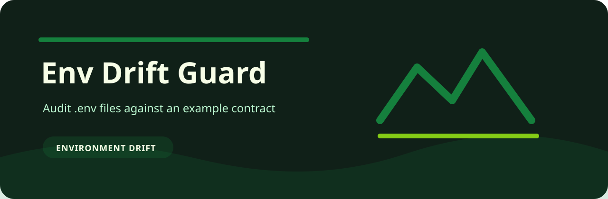
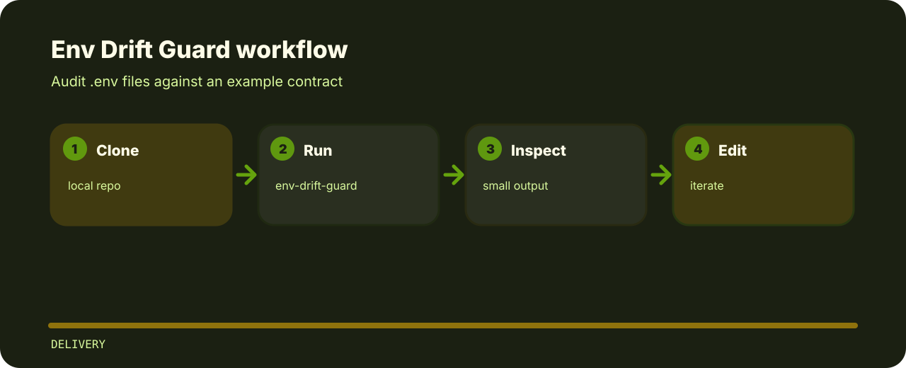

# Env Drift Guard

Audit .env files against an example contract. The repo is kept small on purpose: clone it, run the sample, inspect the output, then adapt the idea.



## Code trail

```text
src/            package source
tests/          test coverage
.gitignore      project file
pyproject.toml  package metadata
```

## Command line

```bash
git clone https://github.com/mertefekurt/env-drift-guard.git
cd env-drift-guard
python -m pip install -e ".[dev]"
env-drift-guard --help
```

## How it runs


